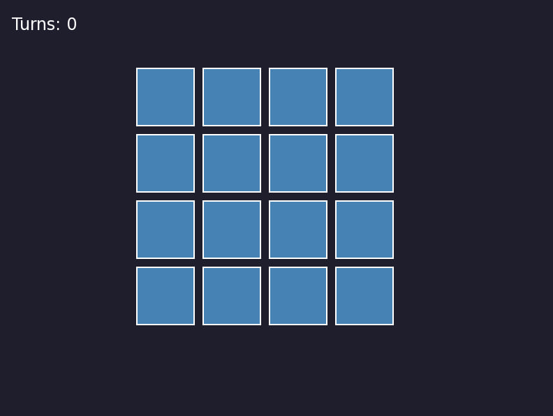
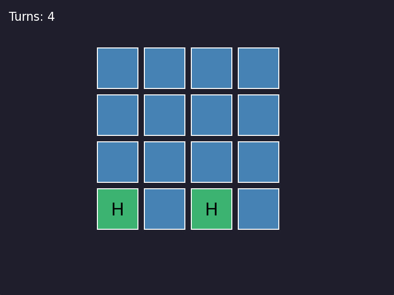
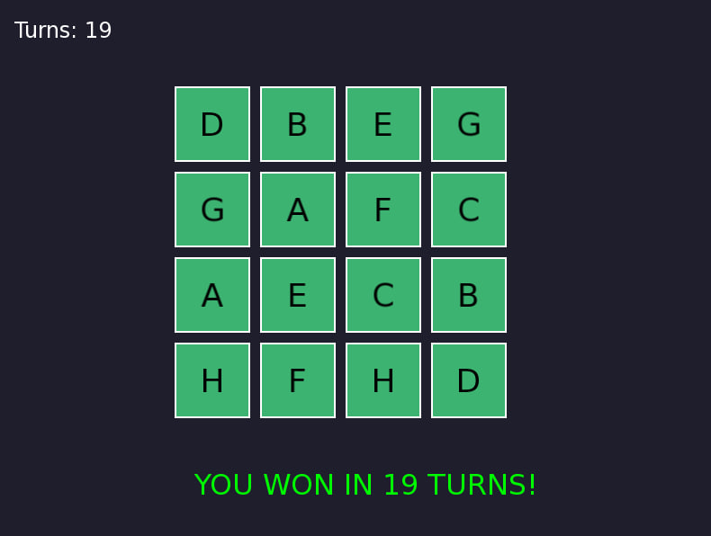

# MemoryGame

A memory-matching card game written in C++17 with a graphical interface built on [SFML](https://www.sfml-dev.org/). Find all matching pairs on a 4×4 board by clicking two cards per turn.

> The original console version is available under the tag `v1.0-console`.

## Screenshots 
<p>
  
  
  
</p>

## How to Play

1. Click a card to reveal it.
2. Click a second card.
3. If the symbols match, the pair stays revealed. Otherwise, both cards are hidden again after one second.
4. The game ends when all pairs are found. Your score is the number of turns taken.

## Build and Run

Requirements: CMake 3.14+, a C++17 compiler and an internet connection on the first build (SFML 2.6.1 is downloaded automatically).

```
mkdir build
cd build
cmake ..
cmake --build .
./MemoryGame
```

On Windows, the executable is `MemoryGame.exe` (inside `build` or `build/Debug`).

On Linux, SFML also needs some system packages, for example on Debian/Ubuntu:

```
sudo apt install libx11-dev libxrandr-dev libxcursor-dev libxi-dev libudev-dev libgl1-mesa-dev libfreetype-dev
```

## Project Structure

```
MemoryGame/
├── assets/
│   ├── DejaVuSans.ttf
│   └── DejaVuSans-LICENSE.txt
├── include/
│   ├── Board.h
│   ├── Card.h
│   └── Game.h
├── src/
│   ├── Board.cpp
│   ├── Card.cpp
│   └── Game.cpp
├── CMakeLists.txt
└── main.cpp
```

## License

The source code is released under the MIT License. The bundled DejaVu Sans font is distributed under its own free license, see `assets/DejaVuSans-LICENSE.txt`.
